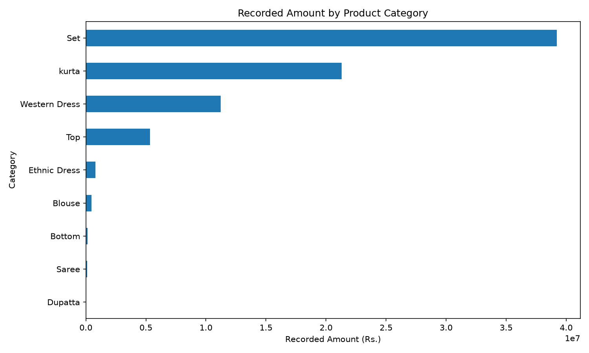
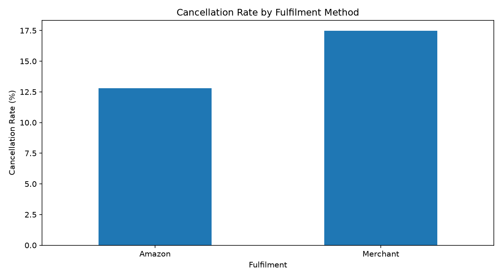
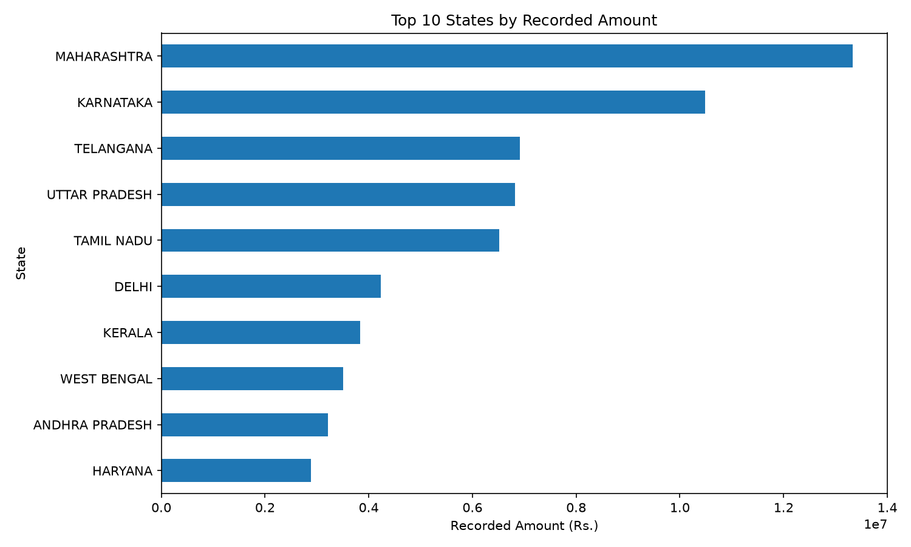
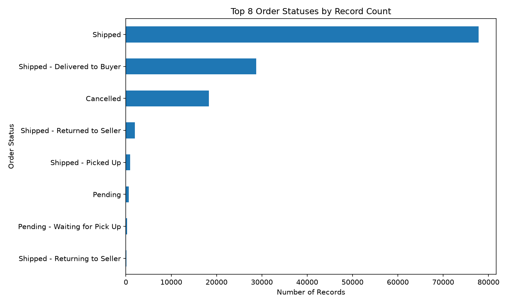

# W11D5 Stakeholder Report

## Indian Business Sales Dataset - Five Business Insights

### Executive summary

The dataset contains **128,975 records** from
**31 March 2022 to 29 June 2022**.

Recorded Amount totals **Rs. 78,592,678.30**, with valid
Amount values available for **93.96%** of records.

The analysis identifies category concentration, fulfilment
cancellation differences, geographic concentration, cancellation
volume, and an exploratory B2B average-amount difference.

> **Important:** Recorded Amount is a dataset field. It is not
> independently verified net revenue, profit, or cash collected.

---

## Five business insights and recommendations

### 1. Product category concentration

The two largest categories are **Set**
and **kurta**. Together they account for
**76.98%** of recorded Amount.

**Business implication:** A large share of recorded Amount is
concentrated in two categories.

**Recommendation:** Monitor stock availability, demand patterns,
and returns for these categories. Review the remaining categories
for opportunities to diversify demand.



### 2. Cancellation rates differ by fulfilment method

Amazon fulfilment has a cancellation rate of **12.79%**,
while Merchant fulfilment has a rate of **17.47%**.

The difference is **4.68 percentage points**.

**Business implication:** The observed cancellation rates differ
between the two fulfilment groups.

**Recommendation:** Review merchant order processing, dispatch
timelines, and cancellation reasons. Compare similar products and
periods before deciding what operational changes are appropriate.

This is a descriptive comparison and does not establish that
fulfilment method causes cancellations.



### 3. Recorded Amount is geographically concentrated

The two leading states are **MAHARASHTRA**
and **KARNATAKA**. Together they represent
**30.30%** of recorded Amount.

**Business implication:** These two states account for a substantial
share of the dataset's recorded Amount.

**Recommendation:** Monitor service levels and stock availability
in these states while reviewing growth opportunities in other
regions.



### 4. Cancellations are an operational signal

There are **18,332 cancelled records**, representing
**14.21%** of all records.

**Business implication:** Cancellation volume is large enough to
deserve operational investigation.

**Recommendation:** Segment cancellations by date, category,
fulfilment method, and state. Investigate the underlying reasons
before proposing corrective actions.

Cancelled Amount must not automatically be described as lost
revenue. The dataset does not establish the financial outcome
of each cancellation.



### 5. B2B records show a higher average recorded Amount

The B2B group has an average recorded Amount of
**Rs. 701.33**, compared with
**Rs. 648.19** for non-B2B records.

The observed difference is **8.20%**.

However, B2B represents only **871 records**
(0.68% of all records).

**Business implication:** The B2B group has a higher observed
average, but it is a small segment.

**Recommendation:** Treat this as an exploratory finding.
Validate with more data and investigate order size, product mix,
and repeat purchasing before designing a B2B strategy.

---

## Supporting monthly context

| Month | Records | Recorded Amount |
|---|---:|---:|
| 2022-03 | 171 | Rs. 101,683.85 |
| 2022-04 | 49,067 | Rs. 28,838,708.32 |
| 2022-05 | 42,040 | Rs. 26,226,476.75 |
| 2022-06 | 37,697 | Rs. 23,425,809.38 |

March and June are partial months in this dataset. Avoid direct
like-for-like comparisons with the full months of April and May.

## Dataset quality and limitations

- Total records: 128,975
- Valid Amount records: 121,180
- Amount coverage: 93.96%
- Missing Amount records: 7,795
- Cancelled records: 18,332 (14.21%)
- Valid date range: 31 March 2022 to 29 June 2022
- Missing Amount values are excluded from Amount totals.
- Recorded Amount is not verified profit or net revenue.
- The analysis uses available records and does not establish causation.
- The dataset covers a limited period, not a full year.
- The B2B group is small and should be interpreted cautiously.

## Reproducibility

Run from the repository root:

```powershell
python reports/w11d5/stakeholder_analysis.py
```

### Generated files

- `outputs/category_analysis.csv`
- `outputs/fulfilment_analysis.csv`
- `outputs/state_analysis.csv`
- `outputs/status_analysis.csv`
- `outputs/b2b_analysis.csv`
- `outputs/monthly_analysis.csv`
- `outputs/charts/category_amount.png`
- `outputs/charts/fulfilment_cancellation.png`
- `outputs/charts/state_amount.png`
- `outputs/charts/order_status.png`
- `outputs/stakeholder_report.md`
